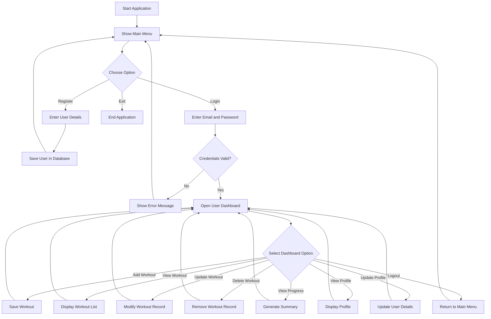
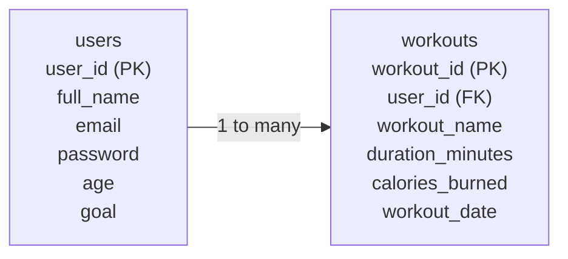

# Diagrams

## Flowchart

## ER Diagram

## Use Case Summary
- Register account
- Login to system
- Add workout
- View workouts
- Update workout
- Delete workout
- View profile
- Update profile
- View progress summary

## Class Diagram Summary
- `Person`
- `User extends Person`
- `Workout`
- `AuthenticationService`
- `ProfileService`
- `WorkoutService`
- `DatabaseConnection`
- `FitnessApp`
